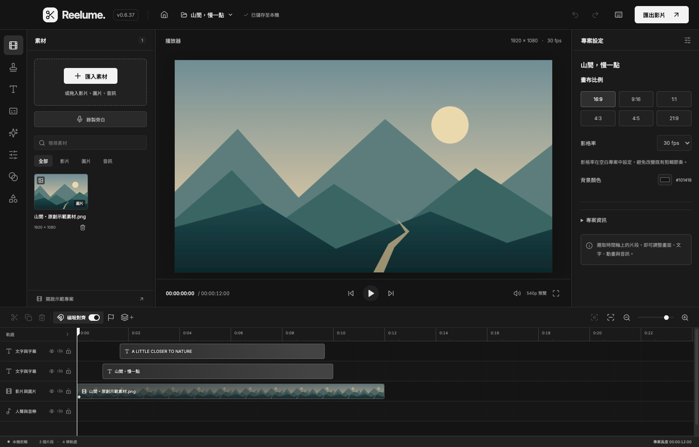

# Reelume

**Mac／Windows 本機多軌影片剪輯器**

把影片、圖片、音樂、文字與字幕放進同一個時間軸，製作日常影片、教學內容或音樂影片。素材處理、語音辨識與影片匯出都在自己的電腦完成，一般剪輯不需帳號或 API 金鑰。選用 AI 剪輯時，需自行設定 API 或 CLI；雲端服務可能需要登入、金鑰與額外費用。

- **多軌剪輯：**修剪、分割、變速、群組、跨軌磁吸與關鍵影格。
- **字幕與歌詞：**離線辨識、原稿對齊、SRT 匯入匯出及卡拉 OK 逐字高亮。
- **畫面與聲音：**40 種特效、40 款 OFL 字型、調色、轉場、錄音與混音。
- **AI 影片剪輯：**影片右鍵產生精華保留區間，預覽後套用；支援相容 API 與自備 CLI。
- **Logo 與音訊：**專案保存 Logo、四角或自訂定位、影片分離音訊及本機人聲分離。
- **暫存管理：**查看資料夾與容量，清除可重建代理檔及已關閉匯出工作的暫存。
- **輸出與備份：**最高 4K、無浮水印 MP4，以及包含原始素材的完整專案包。



[安裝與開啟](#安裝與開啟) · [快速開始](#快速開始) · [時間軸與剪輯](#時間軸與剪輯) · [字幕與歌詞](#字幕與歌詞) · [AI 剪輯](#ai-影片剪輯) · [Logo](#logo) · [暫存管理](#暫存管理) · [匯出與備份](#匯出與備份) · [快捷鍵](#常用快捷鍵) · [常見問題](#常見問題) · [開發與建置](#開發與建置)

自 0.6.37 起，產品正式更名為 **Reelume**。既有安裝會沿用舊版資料位置，保留專案、素材與設定；舊 `.mycutpack` 仍可匯入，新備份使用 `.reelumepack`。內部相容識別與歷史發行紀錄保留原值。

## 安裝與開啟

### 使用封裝版

| 電腦 | 目標系統 | 開啟方式 |
| --- | --- | --- |
| Mac Intel | macOS 14 以上，x64 | 解壓縮 Intel 版本，開啟 `Reelume.app`；可移到「應用程式」 |
| Mac Apple Silicon（M 系列） | macOS 14 以上，arm64 | 解壓縮 Apple Silicon 版本，開啟 `Reelume.app` |
| Windows Intel／AMD | Windows 11，x64 | 執行安裝程式，或完整解壓縮免安裝 ZIP 後開啟 `Reelume.exe` |

完整封裝版包含 FFmpeg、字型、離線語音模型、原稿對齊與人聲分離引擎，不需另外安裝 Node.js 或 Python。Windows 免安裝版須保留整個資料夾內的資源與 DLL；x64 語音引擎需要支援 AVX2 的處理器。

**安裝包不隨 Git 原始碼提供。**本機封裝產物放在 `release/`，可查看 [版本說明](release/使用說明.txt)。若只有原始碼，請依照[開發與建置](#開發與建置)啟動。Windows 與 Apple Silicon 的原生實機驗證仍待完成，歷史測試範圍見[平台驗證紀錄](docs/cross-platform.md#驗證狀態)。

### 從專案資料夾啟動與更新

- **Mac：**雙擊 [啟動 Reelume.command](<啟動 Reelume.command>)，會優先開啟 `release/` 下以版本號命名資料夾中的最新封裝；找不到時再使用一般封裝位置。
- **Windows：**雙擊 [啟動 Reelume.cmd](<啟動 Reelume.cmd>)，若有 `release/win-unpacked/Reelume.exe`，會直接啟動該程式。
- 若沒有對應封裝，啟動腳本會嘗試從原始碼建置，因此仍需完成開發環境準備。

首頁與編輯器左上角會顯示版本號，點選可查看程式位置。重複啟動不同版本時，新版會提示先完全結束原程式；在本機 `release/版本號/` 使用封裝版時，也會提示已找到的同平台、同架構新版。

**Mac 更新後，請先儲存專案並按 `⌘ Q` 完全結束 Reelume，再開啟新版。**關閉編輯視窗會先回到專案首頁；重複啟動時會聚焦既有程式，因此只按紅色關閉按鈕可能仍停留在原版本。

## 快速開始

1. **建立專案。**首頁按「建立新專案」，預設為 1920 × 1080、30 fps，名稱採當天日期。需要直式、方形或不同影格率時，先在空白專案設定。
2. **匯入素材。**左側「素材」統一管理影片、圖片與音訊，可匯入檔案或拖入素材區，再加入時間軸。可在此錄製旁白；對影片按右鍵可「分離音訊」或「AI 剪輯」，影片與歌曲皆可「分離人聲」。
3. **排列與修剪。**拖曳片段安排時間，拉動邊緣調整長度；選取片段後，在右側修改位置、大小、文字或音量。
4. **加入字幕與效果。**從左側「文字」、「字幕」、「特效」、「濾鏡」、「轉場」或「圖形」新增內容，再到右側調整屬性。
5. **匯出影片。**按右上角「匯出影片」，選擇解析度與畫質。桌面版按「開始匯出」時選擇 MP4 儲存位置，完成後自動儲存。

編輯時會自動儲存，也可按 `⌘ S`／`Ctrl S`。首頁可搜尋、重新命名、複製專案，或從回收區還原。

| 區域 | 負責的操作 |
| --- | --- |
| 左側功能區 | 匯入、新增、辨識、錄音、挑選效果與批次處理 |
| 中央播放器 | 預覽、播放／暫停與定位影格 |
| 右側屬性區 | 編輯所選片段的內容、樣式、時間及效果參數 |
| 下方時間軸 | 排列片段、修剪長度、管理軌道與移動播放頭 |

滑鼠停在圖示上或用 `Tab` 聚焦，可查看功能提示。播放器左右的分隔線可拖曳調整寬度，按兩下可重設該側寬度。

## AI 影片剪輯

### 操作流程

1. 在**素材庫影片**或**時間軸影片片段**按右鍵 →「AI 剪輯」。圖片與音訊不顯示此選項。
2. 選 API 或 CLI，完成下方設定，按「測試連線」。
3. 輸入要求，例如「保留主角出現且畫面清楚的片段，剪成精華」。開始分析後可取消。
4. 檢視 AI 提供的保留區間與原因，播放預覽，確認後套用；結果不合適可修改要求重新分析。
5. 套用後可用 `⌘ Z`／`Ctrl Z` 復原。

| 操作位置 | 套用結果 |
| --- | --- |
| 素材庫 | 將保留區間接續加入可編輯的影片軌尾端 |
| 時間軸 | 從選取片段的起點開始，以保留區間替換原片段；其他軌道及後續片段不移動，可能留下空隙 |

鎖定、群組或音畫連動的影片片段須先解除限制。分析期間若修改了目標片段，需重新分析後再套用。

### API 設定

- **網址：**填完整的 Chat Completions 相容端點，例如自架服務的 `http://127.0.0.1:8000/v1/chat/completions`。遠端服務須用 HTTPS；HTTP 僅允許本機回環位址。
- **模型：**填服務實際提供、支援圖片輸入的模型名稱。
- **金鑰：**依服務要求填入。金鑰只保留於目前介面工作階段，不寫入持久設定；重新載入或重啟後需重新輸入。

API 會接收剪輯要求及抽樣畫面。請依所選服務確認圖片支援、用量與資料處理方式；單純文字聊天端點不適用。

### CLI 設定

CLI 僅支援桌面版。先自行安裝並完成工具要求的登入，再選擇**執行檔完整路徑**，填寫 JSON 字串陣列形式的參數。

```json
["--prompt", "{prompt}"]
```

這是參數格式示例；`--prompt` 必須換成該 CLI 實際支援的選項。`{prompt}` 會替換為完整剪輯提示，沒有此標記則從標準輸入傳入。程式直接啟動執行檔，不執行 shell 指令；不要填入管線或整串終端機命令。

Windows 不直接執行 `.cmd`／`.bat`。npm 安裝的 CLI 可選 `node.exe`，並將工具入口腳本的完整路徑放在參數陣列第一項。

CLI 會收到抽樣圖片的本機路徑，必須能讀取圖片並將結果輸出至標準輸出；結果格式為：

```json
{"segments":[{"start":0,"end":2,"reason":"保留主角清楚入鏡的畫面"}]}
```

`start`／`end` 是**原始影片的秒數**，必須位於本次分析範圍內，依時間排列且不重疊；最多 20 段。也接受 Markdown JSON 程式碼區塊及 Gemini 形式的 `response` 字串外層。自己的 AI 可實作相同協定。

Reelume 不會自動搜尋、安裝或登入 Gemini、Grok、ChatGPT 等工具；能否使用取決於所選 API／CLI 的圖片輸入與輸出格式。CLI 也可能呼叫雲端服務，並不保證離線。

#### Codex、Claude Code、Gemini CLI 呼叫範例

以下設定填在 Reelume「影片右鍵 → AI 剪輯 → 本機 CLI」。**CLI 在本機執行，不等於模型離線執行**；三者仍依自己的登入、模型與服務設定處理資料。Reelume 的 API Key 欄位不會提供給 CLI。

先在終端機完成各工具安裝與登入，再找出路徑：

```sh
# macOS／Linux：只查找已安裝的工具
command -v codex
command -v claude
command -v gemini
command -v node
```

Windows 可用 `where.exe codex`、`where.exe claude`、`where.exe gemini`、`where.exe node`。請填完整路徑；`~`、`$HOME`、`%APPDATA%` 不會由 Reelume 展開。

若結果是 npm 啟動腳本，或桌面版出現找不到 `node`，將「CLI 執行檔」改成 Node 的完整路徑，並把 CLI 的 JavaScript 入口放在參數第一項。可用 `npm root -g` 查全域套件目錄，再查看對應套件 `package.json` 的 `bin` 欄位取得入口；不要把 `.cmd` 當作 JavaScript 入口。Windows JSON 路徑可用 `/`，或把反斜線寫成 `\\`。

**Codex**

先執行 `codex login`，已登入可用 `codex login status` 確認。若直接指定 Codex 執行檔，參數為：

```json
["exec", "--skip-git-repo-check", "--sandbox", "read-only", "--ephemeral", "--color", "never", "{prompt}"]
```

本專案這台 Mac 已確認 Codex CLI 0.163.0，可用以下 Node 啟動方式。這是本機實際路徑，其他電腦或更新 Node 後需重新查找。

「CLI 執行檔完整路徑」：

```text
/Users/regan/.nvm/versions/node/v22.22.2/bin/node
```

「CLI 參數」：

```json
[
  "/Users/regan/.nvm/versions/node/v22.22.2/lib/node_modules/@openai/codex/bin/codex.js",
  "exec",
  "--skip-git-repo-check",
  "--sandbox", "read-only",
  "--ephemeral",
  "--color", "never",
  "{prompt}"
]
```

不加 `--json`，因為它輸出 JSONL 事件而非單一剪輯結果。`exec` 的一般輸出會將最後回覆寫至標準輸出；模型須能使用圖片檢視工具讀取提示中的本機圖片。未指定 `--model` 時沿用 Codex 的模型設定。參數說明見 [OpenAI 官方非互動模式文件](https://developers.openai.com/codex/noninteractive/)。

**Claude Code**

先在終端機執行 `claude` 完成首次登入，或使用 `claude auth login`。將「CLI 執行檔」設為 `command -v claude` 找到的完整路徑；使用 npm 版時亦可套用上述 Node 啟動方式。

```json
[
  "-p", "{prompt}",
  "--output-format", "text",
  "--tools", "Read",
  "--allowedTools", "Read",
  "--add-dir", "/請替換為實際的Reelume資料目錄"
]
```

把最後的路徑替換為實際資料根目錄：首頁「暫存管理」顯示的 `cache` 資料夾上一層。抽樣圖片會放在其 `ai-temp/` 內。`Read` 用來讀取圖片；`--tools` 限制內建工具，`--allowedTools` 允許其在非互動模式讀取。這不會停用自行設定的 MCP 或 hooks。

使用 `text` 讓模型的最後回覆直接交給 Reelume；不要改成 Claude 的 `json` 或 `stream-json`，Reelume 目前沒有解析其結果外層。登入、參數與非互動行為見 [Claude CLI 參考](https://code.claude.com/docs/en/cli-reference)及[程式化呼叫說明](https://code.claude.com/docs/en/headless)。

**Gemini CLI**

先在終端機執行 `gemini`，依提示完成登入與首次設定。將「CLI 執行檔」設為 `command -v gemini` 找到的完整路徑；npm 版遇到 Node 路徑問題時，使用 Node 加上套件 `bin` 入口。

```json
[
  "-p", "{prompt}",
  "--output-format", "json",
  "--include-directories", "/請替換為實際的Reelume資料目錄"
]
```

把資料目錄換成上述實際資料根目錄，讓圖片位於 Gemini 的工作範圍。其 `read_file` 工具可讀取圖片；若本機信任或工具政策拒絕讀取，需先在終端機完成對應設定。Reelume 會讀取 Gemini JSON 外層的 `response` 字串，裡面仍須是 `segments` 剪輯 JSON；不要選 `stream-json`。

詳見 [Gemini 登入設定](https://geminicli.com/docs/get-started/authentication/)、[非互動輸出格式](https://geminicli.com/docs/cli/headless/)、[CLI 參數](https://geminicli.com/docs/cli/cli-reference/)及[圖片讀取工具](https://geminicli.com/docs/tools/file-system/)。

**連線與實際剪輯檢查**

設定好後先按「測試連線」，再用短影片「產生剪輯建議」。要求可寫：「請讀取提供的抽樣圖片，保留主角清楚入鏡的片段，只回傳指定格式的剪輯結果。」測試連線不會驗證實際圖片讀取；若分析失敗，檢查圖片權限、模型圖片能力、輸出格式與 180 秒逾時限制。

| 狀況 | 檢查方式 |
| --- | --- |
| 找不到執行檔／`node` | 重新查完整路徑，npm 版改用 Node 加 JS 入口；不能填 shell alias |
| Codex 提示模型需要新版 CLI | 更新實際被 Reelume 呼叫的 Codex 安裝；本機曾在 0.140.0 搭配 `gpt-6-astra` 失敗，更新到 0.163.0 後通過連線測試 |
| 要求登入或互動確認 | 先在終端機完成同一使用者的登入與必要讀取設定，Reelume 不提供 CLI 互動終端機 |
| 結果不是有效 JSON | 確認使用上方輸出格式，模型只回覆 `segments` JSON，沒有額外說明 |
| 測試連線成功但無法分析 | 檢查是否能讀取資料目錄內 `ai-temp/` 的圖片；不要只靠檔名猜測內容 |

以上為依官方文件整理的接法。Codex 路徑、版本及登入狀態已在這台 Mac 查核，並已從 Reelume 0.6.38 封裝版通過真實 Codex 連線測試（CLI 0.163.0，約 19 秒）；尚未用三家雲端服務完成影片分析，這台的 PATH 中也未找到 Claude／Gemini。不同 CLI 版本仍需以各自 `--help` 和實際短片測試確認。

### 目前範圍與限制

目前是依抽樣畫面選取影片區間，最多抽取 12 張圖，**不分析聲音、對白、節拍或每一影格**，不會自動新增字幕、音樂、Logo 或轉場。短暫動作可能未被抽樣捕捉，套用前請預覽。分析逾時上限為 180 秒；失敗不會修改時間軸。

「測試連線」只確認基本連通與回應，實際圖片分析仍需成功產生方案。已驗證模擬 API、CLI 與桌面套用／復原流程；未逐一驗證第三方付費服務及各家 CLI 版本。

## Logo

左側「Logo」可匯入 PNG、JPG 或 WebP，建議使用透明 PNG。匯入後會複製到本機資料目錄的 `projects/<專案 ID>/logos/`，重新開啟專案可直接選用，完整專案包也會包含這些圖片。

選擇左上、右上、左下、右下，或使用自訂 X／Y 座標與大小後按「加入影片」。Logo 會建立在最上層，預設顯示至目前片尾；可在時間軸調整時間，或在預覽拖曳位置。

## 時間軸與剪輯

| 操作 | 使用方式 |
| --- | --- |
| 移動與修剪 | 拖曳片段移動時間位置，拉動左右邊緣修剪；單一片段可移到相容軌道 |
| 分割與刪除 | 選取片段後在播放頭位置分割；同軌漣漪刪除可讓後方片段接上 |
| 多選與群組 | 在空白處框選，或按住 `Shift`／`⌘`／`Ctrl` 點選，再一起移動、修剪、分割或建立群組 |
| 跨軌磁吸 | 開啟「磁吸對齊」，移動或修剪時可吸附同軌、上下軌道片段的起點與終點；出現對齊線即已吸附，拖遠可解除 |
| 畫面層級 | 圖片與影片重疊時，**越上方的軌道越優先顯示**；透明或未覆蓋區域會露出下層 |
| 滾輪縮放 | 游標放在時間軸，Mac 按住 **`Command ⌘`**、Windows 按住 **`Alt`** 滾動；向上放大、向下縮小時間刻度與片段寬度 |
| 手動縮放 | 時間軸右上方的放大／縮小按鈕、滑桿與「符合整段影片」仍可使用，和滾輪同步同一個縮放設定 |
| 符合選取片段 | 選取一個或多個片段，按右上方「符合選取片段」，將選取範圍放入視野 |
| 邊緣自動捲動 | 拖曳片段或修剪左右邊緣時，將游標停在時間軸左／右邊緣，畫面會持續捲動；放開滑鼠或切換視窗即停止 |
| 直接輸入數值 | 右側縮放、不透明度與中心裁切的數字框可輸入數字；`Enter` 或移開焦點套用，`Esc` 取消 |
| 軌道管理 | 可鎖定、隱藏或靜音軌道；不同軌道可同時播放，用於疊圖、字幕和混音 |

**圖片對齊音樂結尾：**開啟磁吸，將圖片右邊緣拉到音樂片段的右邊緣，看到對齊線後放開。音樂可在不同軌道；距離太遠時，可先用「符合整段影片」找到結尾，再放大微調。

同一軌道的片段不會重疊。新增文字、圖形與時段特效會從「播放頭或軌道末端較後的位置」開始；新增字幕則從播放頭開始，遇到重疊時會使用其他文字軌。字幕可拖到文字軌上、下邊緣新增軌道，多餘的空文字軌會自動清理。

片段屬性的「最近設定」會自動記錄調整過的外觀、動畫、調色、音訊及速度，每個片段保留最新一組，最多 50 組。可跨專案選擇同類型片段並按「套用片段設定」，重新啟動後仍可使用；套用保留素材、文字內容及時間軸位置，文字外觀依原有規則同步同軌字幕，並可復原。設定保存在資料目錄的 `clip-presets.json`。


更完整的群組、音畫連動與時段特效操作，見[工作流程指南](docs/workflow-guide.md)。

## 字幕與歌詞

### 手動文字、字幕與字型

左側「文字 → 新增文字」適合標題；「字幕 → 新增字幕」可從播放頭加入一句字幕。選取片段後，從右側「文字」編輯內容、字型、字級、顏色、位置與時間。

右側「字幕」分頁按時間列出所有文字與字幕，可搜尋、點選定位，或按每列右側的**垃圾桶刪除該句**。刪除會同步更新時間軸，支援復原／重做；鎖定軌道的字幕不能刪除。

字型清單支援搜尋與星號最愛。新增文字與字幕會使用完整列表中第一款已勾選的最愛；未設定時使用「思源黑體 TC」。既有片段不會因預設字型改變而被替換。內建 10 款繁中字型與 30 款英文字型，完整名稱、來源及 OFL 授權位置見[字型清單](public/fonts/manifest.json)。

字型選單提供「匯入自己的字型」，支援單個 32 MB 以內的 TTF／OTF 檔案。匯入後自動套用，可加入最愛，重新啟動仍可使用，預覽與原生匯出皆使用匯入字型。檔案儲存在資料目錄的 `custom-fonts/`；完整專案包會攜帶使用到的自訂字型，還原時自動匯入；JSON 專案檔不包含字型。自訂字型檔遺失或損壞時會暫用思源黑體，並保留原字型設定；重新匯入原檔案即可恢復。包含自訂字型的新專案包需使用 0.6.28 以上版本開啟，舊版專案包仍可匯入。

新增文字與字幕預設字級為 70；在右側「文字」可直接輸入「字級」數值，按 Enter 或離開輸入欄位即可套用。同軌已有外觀設定時會沿用該設定。

選取文字或字幕片段，在右側「文字」調整「黑色描邊」粗細（0–12 px，0 表示關閉）。描邊在預覽與匯出皆有效，並依文字外觀規則同步至同軌字幕。

### 自動辨識與原稿對齊

| 手上的內容 | 操作方式 |
| --- | --- |
| 只有人聲影片或音訊 | 加入時間軸後，在左側「字幕」選「自動字幕」或「自動歌詞」，選擇範圍與語言，開始辨識 |
| 已有正確字幕或歌詞原稿 | 按「輸入原稿並對齊」，讓原稿對齊時間軸的聲音；音訊時間軸上限為 **20 分鐘，含 20:00** |
| 已有 SRT 檔 | 從左側「字幕」匯入，再調整文字、樣式與時間 |

自動辨識使用本機 CPU 與多語言 Whisper Small Q5_1 模型，工作可暫停與續跑。完成後按「校對與加入」，確認文字及起訖時間。歌唱、重伴奏或合唱仍需人工校對；若改動來源音訊的時間軸，需重新辨識。

原稿未成功定位的句子會保留在「待手動校時」，可用目前播放位置或手動輸入秒數設定時間，再逐句加入；不會為未定位的文字編造時間。

### 逐字高亮、批次編輯與字幕匯出

- **卡拉 OK：**選取歌詞片段，在右側「文字 → 卡拉 OK 歌詞」設定高亮顏色，並用「逐字校時」播放打點或輸入字詞時間。中文可按字重新分段。
- **批次整理：**左側「字幕 → 字幕批次編輯」可搜尋取代、整理標點、調整每行字數與統一樣式，先預覽再套用，整批操作可一次復原。
- **匯出 SRT：**左側「字幕 → 匯出 SRT」預設匯出字幕與歌詞，也可包含標題；尚待手動校時的原文不會加入 SRT。
- **匯出逐字 LRC：**選取已有有效逐字時間的歌詞，再按「匯出所選歌詞 LRC」。

細節見[字幕與歌詞指南](docs/editor-guide.md#自動字幕與自動歌詞)及[原稿對齊說明](LYRICS_ENGINE_INTEGRATION.md)。

## 特效與音訊

| 功能 | 入口與用途 |
| --- | --- |
| 全片效果 | 左側「特效 → 全片效果」，可疊加多種效果，點同一張卡片關閉 |
| 時段特效 | 左側「特效 → 時段特效」，加入獨立片段，再調整起點、長度、淡化與強度動畫 |
| 調色與去背 | 左側「濾鏡」選預設，右側「調色」調整亮度、對比、飽和度、模糊與色度去背 |
| 動畫與轉場 | 右側「動畫」新增位置、縮放與透明度關鍵影格；左側「轉場」選淡化或交叉溶解 |
| 錄製旁白 | 左側「素材 → 錄製旁白」 |
| 分離音訊 | 在素材庫或時間軸影片上按右鍵；來源須含音訊。時間軸操作會將原影片靜音並建立獨立音訊片段；素材庫操作不會修改既有影片片段 |
| 分離人聲 | 在影片或歌曲上按右鍵，以本機 Demucs 分離完整來源的人聲 WAV，完成後加入原專案素材庫，再自行加入時間軸；可取消，原始素材保留 |
| 音量與降噪 | 選取音訊片段，在右側「音訊」調整音量、淡入淡出與穩態噪音抑制；降噪在匯出時生效 |

人聲分離模型準備好後可離線執行。CPU 處理長歌曲可能需要數分鐘，重伴奏或合唱仍可能有殘留；無聲影片或遺失的來源無法處理。

40 種特效涵蓋氛圍、光影、節奏與畫面處理，可查看[效果說明](docs/editor-guide.md#特效)和[特效美術總覽](docs/artwork-effects.png)。全片與時段特效都作用於合成畫面，包含文字與字幕。節奏效果需要未靜音的音訊，首次使用時會進行音訊分析。

## 匯出與備份

### 匯出 MP4

按「匯出影片」，選擇 **720p／1080p／4K**、畫質與可用編碼器。成品使用 H.264 視訊與 AAC 音訊，沒有浮水印；Mac 可使用 Apple 硬體加速，Windows 使用軟體編碼。預覽使用較低解析度協助編輯，匯出使用原始素材。

匯出視窗**只顯示當次工作**，可暫停並繼續，不保留歷史工作清單。執行中取消、關閉視窗或按 `Esc`，會詢問是否取消：按「確定」停止並關閉，按「否」繼續工作。桌面版在開始時選擇成品位置，完成後自動儲存，可按「顯示檔案」開啟所在資料夾；瀏覽器版仍使用「儲存影片」下載。

匯出採分段處理，請為成品與暫存保留足夠磁碟空間。一小時 1080p／4K 的完整壓力測試尚未完成；處理方式與已驗證範圍見[長片指南](docs/editor-guide.md#長片處理)。

### 專案快照與還原

從首頁專案卡片的「專案快照」，或編輯器的「專案管理 → 專案快照」開啟。

- 專案修改並儲存時，會保留修改前的狀態；自動快照間隔至少 **5 分鐘**，也能按「建立快照」立即保存。
- 每個專案最多保留最新 **10 份**，包含手動快照；列表會顯示快照建立時間及內容儲存時間。
- 選取快照後按「還原為新專案」，會開啟一份名稱含「還原」的新專案，原專案保留。
- 主檔損毀時會嘗試上一份備份，再嘗試最近的有效快照；首頁會標示備援來源。

快照存放在資料目錄的 `snapshots/<專案 ID>/`，只保存剪輯設定與素材參照。要包含原始素材，請使用完整專案包。

### 備份或搬到另一台電腦

| 格式 | 包含內容 | 適合用途 |
| --- | --- | --- |
| `.reelume.json` | 剪輯設定與素材參照 | 在原本媒體庫保留或還原剪輯設定 |
| `.reelumepack` | 剪輯設定、本專案全部原始素材、Logo 及使用的自訂字型，包含尚未加入時間軸的素材 | 完整備份，或搬移至另一台 Mac／Windows |

在桌面版按上方專案名稱，開啟「專案管理 → 打包完整專案」，儲存 `.reelumepack`。目的電腦從首頁「開啟專案檔」匯入，會建立新的專案與素材；字型最愛不隨專案包搬移。

舊 `.mycut.json`、`.mycut` 與 `.mycutpack` 仍可匯入；新匯出使用 Reelume 副檔名。

桌面選檔匯入的素材以本機檔案參照讀取，請保留原始檔案；若移動位置，可在素材卡片按「重新連結」。要備份整個工作環境，請退出程式後，同時備份資料目錄與原始素材。

| 執行方式 | 預設資料位置 |
| --- | --- |
| Mac 封裝版 | `~/Library/Application Support/Reelume/workspace/` |
| Windows 封裝版 | `%APPDATA%\Reelume\workspace\` |
| 原始碼開發版 | 專案目錄下的 `.mycut/` |

上表是全新安裝的預設位置。若新位置尚無專案且偵測到舊 `MyCut/workspace/projects`，桌面版會沿用舊資料夾，不搬動素材。封裝版指定 `--user-data-dir` 時，資料放在該目錄的 `workspace/`；桌面環境變數 `REELUME_DATA_DIR`（亦相容 `MYCUT_DATA_DIR`）則直接指定資料根目錄。實際路徑可由首頁「暫存管理」查看。


## 暫存管理

在專案首頁按「暫存管理」，可查看代理檔與匯出暫存的資料夾路徑、可清理容量，並開啟資料夾。按「清除暫存」並確認後，會刪除預覽代理檔和已關閉匯出工作的內部檔案（包含內部 MP4 成品）。請先將需要的成品另行儲存。

專案、Logo、原始素材、縮圖與目前匯出工作（含暫停及失敗）會保留；代理檔可重新建立。

## 常用快捷鍵

一般編輯快捷鍵適用於編輯畫面，輸入文字或開啟對話框時不會被攔截。滾輪縮放需將游標放在下方時間軸。

| 動作 | Mac | Windows |
| --- | --- | --- |
| 時間軸縮放 | **`⌘`＋滾輪** | **`Alt`＋滾輪** |
| 播放／暫停 | `Space` | `Space` |
| 全選片段 | `⌘ A` | `Ctrl A` |
| 群組／解除群組 | `⌘ G`／`⌘ Shift G` | `Ctrl G`／`Ctrl Shift G` |
| 分割／複製片段 | `⌘ B`／`⌘ D` | `Ctrl B`／`Ctrl D` |
| 儲存專案／匯出影片 | `⌘ S`／`⌘ E` | `Ctrl S`／`Ctrl E` |
| 復原 | `⌘ Z` | `Ctrl Z` |
| 重做 | `⌘ Shift Z` | `Ctrl Shift Z` 或 `Ctrl Y` |
| 刪除片段 | `Delete`／`Backspace` | `Delete`／`Backspace` |
| 同軌漣漪刪除 | `Shift Delete`／`Shift Backspace` | `Shift Delete`／`Shift Backspace` |
| 前後一影格／一秒 | `←`、`→`／加 `Shift` | `←`、`→`／加 `Shift` |
| 加入標記／快捷鍵說明 | `M`／`?` | `M`／`?` |

## 常見問題

| 問題 | 處理方式 |
| --- | --- |
| 更新後仍像舊版 | Mac 先儲存並按 `⌘ Q` 完全退出，再使用啟動腳本開啟最新版 |
| Option＋滾輪沒有縮放 | Mac 已改成 **Command＋滾輪**；Windows 仍使用 Alt。游標需放在時間軸 |
| 找不到左側「音訊」 | 音訊已整合至「素材」，可用「音訊」篩選或錄製旁白；分離音訊改在影片右鍵選單 |
| AI 剪輯沒有出現 | 只對影片顯示；在素材庫影片或時間軸影片上按右鍵 |
| 分離音訊反灰 | 確認來源可讀且含音訊；時間軸片段也須符合可編輯條件 |
| 圖片被蓋住 | 檢查軌道層級；上方軌道會蓋住下方，並確認片段時間、可見狀態及不透明度 |
| 字幕無法刪除 | 使用右側字幕清單的垃圾桶，並確認該軌道未鎖定 |
| 新增文字出現在後面 | 文字會從軌道末端或更後方的播放頭開始；需要從播放頭新增一句時，使用「新增字幕」 |
| 專案素材離線 | 保留原始檔案位置，或按「重新連結」；跨電腦搬移請使用 `.reelumepack` |
| 匯出空間不足 | 清出專案資料所在磁碟的空間，將分段暫存容量一併計入 |
| `release/` 可以刪嗎 | 可刪除不再使用的舊版；若靠啟動腳本開啟封裝版，請保留目前使用的程式。專案資料另存在資料目錄 |
| 原始碼版缺字型、語音模型或對齊引擎 | 按下方步驟安裝對應資源；這些大型檔案不納入 Git |

## 開發與建置

主要使用 **TypeScript、React、Electron 與 Node.js**；影音由 FFmpeg 處理，自動辨識使用 whisper.cpp，原稿對齊使用本機 Python 引擎。

### 環境與首次啟動

- **Node.js 22 以上**與 npm。
- Mac 編譯語音引擎需要 **Xcode Command Line Tools** 與 **CMake**。
- 原稿對齊的開發與封裝需要 **CPython 3.12**，目前建置腳本接受 3.9–3.12。封裝版使用者不需另外安裝 Python。
- 首次安裝套件、字型與模型需要網路；大型下載、快取及原生建置需要額外磁碟空間。

在專案根目錄執行：

```sh
npm ci
npm run fonts:install
npm run speech:install
npm run desktop
```

`npm run desktop` 會先建置再開啟 Electron。日常開發可用 `npm run dev`，瀏覽器介面位於 `http://127.0.0.1:5173`；原生選檔、重新連結及完整專案包操作請使用桌面版。

若要使用「輸入原稿並對齊」，再準備對齊模型與引擎，完成後重新啟動桌面版：

```sh
npm run lyrics-aligner:setup
npm run lyrics-aligner:assets
npm run lyrics-aligner:build
```

指定 Python 路徑、相依版本與建置方式見[歌詞引擎建置說明](LYRICS_ENGINE_INTEGRATION.md#建置及封裝)。

### 驗證與測試

```sh
npm run typecheck
npm test
npm run build
npm run test:ui
```

介面測試使用正式建置的 `dist/`，因此需先執行 `npm run build`。需要 Chrome 或 Playwright Chromium；若未安裝，可執行 `npx playwright install chromium`，或以 `PLAYWRIGHT_CHROME_PATH` 指向 Chrome。

| 指令 | 驗證內容 |
| --- | --- |
| `npm run test:effects` | 特效實際匯出與分段處理 |
| `npm run test:workflow` | 群組、字幕批次與時段特效流程 |
| `npm run test:desktop` | 桌面版原生功能；需先備妥封裝版 |
| `npm run lyrics-aligner:evaluate -- --manifest <檔案>` | 使用人工標註評估歌詞對齊準確度 |

### 封裝應用程式

先完成套件、字型與建置環境準備。**封裝必須在目標作業系統及相同 CPU 架構上執行**，目前腳本會拒絕跨平台或跨架構建置原稿對齊引擎。

| 建置電腦 | 指令 |
| --- | --- |
| Mac，目前架構 | `npm run package:mac` |
| Intel Mac | `npm run package:mac:x64` |
| Apple Silicon Mac | `npm run package:mac:arm64` |
| Windows x64 | `npm run package:win` |

封裝腳本會準備對齊模型、建置原生引擎與前後端，並安裝目標平台的語音資源，產物位於 `release/`。目前尚未提供 Apple 公證或 Windows 發行者簽章。

### 本機人聲分離

在素材庫或時間軸的影片、歌曲上按右鍵，選擇「分離人聲」。完成後，完整來源的獨立人聲 WAV 會加入原專案素材庫，再自行加入時間軸。進度面板可取消工作；原始素材與既有剪輯保留。無聲影片與遺失的來源無法處理。

開發環境先執行 `npm run vocals:setup`，安裝獨立 Python 環境與官方 Demucs 模型。與對齊引擎相同，需 CPython 3.9–3.12；可用 `PYTHON` 指定。模型下載一次後，分離可離線執行，不上傳素材。CPU 處理長歌曲可能需要數分鐘，重伴奏或合唱可能仍有殘留。

`npm run vocals:build` 產生不需外部 Python 的原生引擎；桌面封裝腳本會自動執行，並包含模型與授權文件。引擎須在目標平台原生建置。`node --import tsx --test tests/vocals.test.ts` 在已安裝引擎時會實際驗證混音分離、音訊長度、素材歸屬及取消。

### 專案結構

| 目錄 | 內容 |
| --- | --- |
| `src/` | 編輯介面、播放器與時間軸 |
| `shared/` | 專案模型、剪輯邏輯、特效與平台共用程式 |
| `server/` | 本機媒體庫、專案保存、辨識及匯出服務 |
| `electron/` | 桌面視窗、原生檔案操作與前後端橋接 |
| `scripts/`、`tests/` | 資源安裝、封裝、驗證腳本與測試 |
| `tools/lyrics-aligner/`、`tools/vocal-separator/` | 本機原稿對齊與人聲分離引擎 |
| `public/`、`resources/` | 介面素材、字型、模型及平台執行檔 |
| `docs/` | 操作指南與驗證紀錄 |

`dist/`、`dist-server/`、`release/`、下載快取與大型執行資源不納入 Git，可由安裝與建置腳本產生。`.mycut/` 與桌面版資料目錄是使用者資料，清理建置產物時請保留。

## 延伸閱讀與授權

| 文件 | 內容 |
| --- | --- |
| [編輯與長片指南](docs/editor-guide.md) | 特效、字幕、卡拉 OK 與長片處理細節 |
| [工作流程指南](docs/workflow-guide.md) | 群組、音畫連動、字幕批次與完整專案包 |
| [原稿對齊引擎](LYRICS_ENGINE_INTEGRATION.md) | 對齊流程、限制、Python 環境與封裝方式 |
| [歌詞對齊評估](docs/lyrics-alignment-evaluation.md) | 準確度評估方法與人工標註格式 |
| [版本說明](release/使用說明.txt) | 近期變更與封裝版使用方式 |
| [歷史平台紀錄](docs/cross-platform.md)、[歷史驗證紀錄](docs/validation.md) | 各版本的測試條件與平台限制；目前建置方式以上方指令為準 |
| [第三方元件與授權](THIRD_PARTY_NOTICES.md) | 字型、影音引擎、模型及其他元件的授權聲明 |
